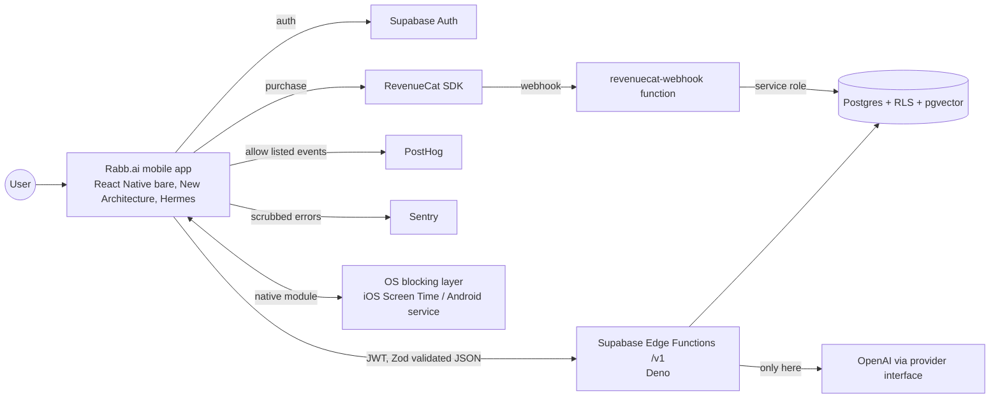
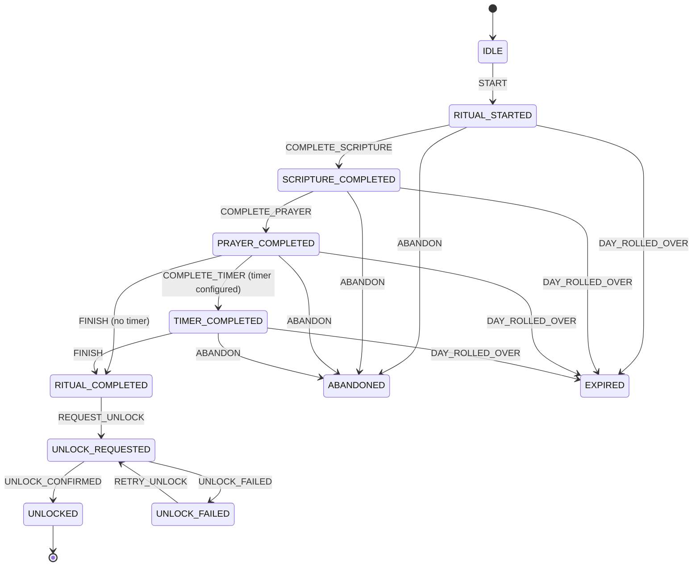
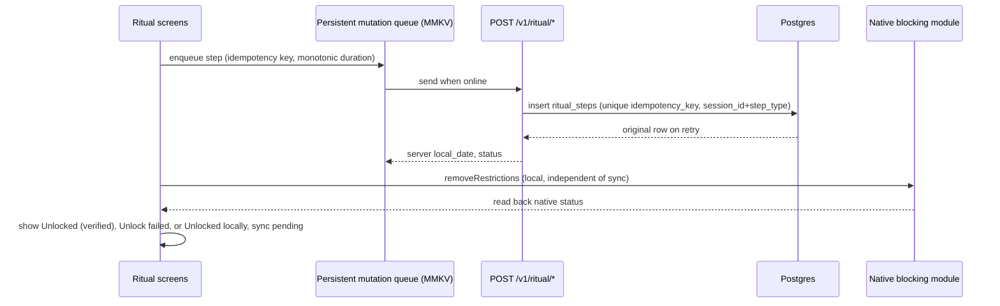
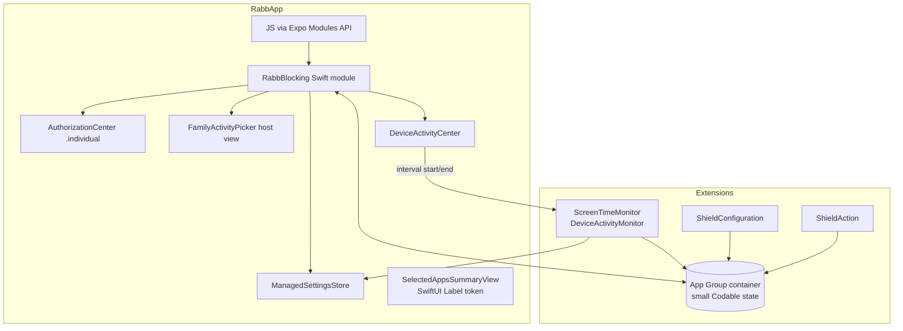
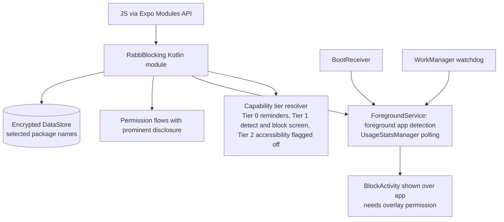
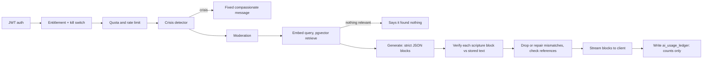

# Architecture

## System context



## Monorepo

```
apps/mobile            React Native app, ios/ and android/ committed
apps/admin             README only
packages/ritual-engine pure reducer, no React, no IO
packages/schedule-core day boundary, recurrence, DST, next restriction, streaks
packages/contracts     Zod schemas and types shared by app and Edge Functions
supabase/              migrations, functions, tests (pgTAP), seed
```

Dependency direction: `apps/mobile` and `supabase/functions` depend on `contracts`, `ritual-engine`, `schedule-core`. The packages depend on nothing but `zod` (contracts only). Edge Functions import packages through a Deno import map pointing at the workspace sources.

## Ritual state machine



Order decision: scripture first, then prayer. Prayer before scripture is an illegal transition and is tested. Reason: the product promise is "read the verse, complete the prayer", and the prayer screen references the day's verse.

## Completion data flow



The unlock never waits for the network. The UI state after unlock is derived from the native status read-back plus the queue length.

## iOS blocking



Selection tokens are written to the App Group only. No token and no count of any identity leaves the device. JS receives `{count, categoryCount, webDomainCount}`.

## Android blocking



Tier 2 lives in a separate build flavor, `accessibility`, and is not part of the default `play` flavor.

## AI tutor pipeline



Retrieval never includes `prayer_journal` rows unless that entry has `ai_opt_in = true`.

## Data model summary

Core tables: `profiles`, `user_preferences`, `ritual_schedules`, `ritual_sessions`, `ritual_steps`, `user_streaks`, `prayer_journal`, `subscriptions`. Content: `scripture_translations`, `scripture_content`, `daily_verses`, `daily_prayers`, `learning_paths`, `learning_lessons`, `quiz_questions`, `quiz_attempts`, `content_chunks`. Platform: `tutor_threads`, `tutor_messages`, `ai_usage_ledger`, `rate_limit_counters`, `feature_flags`, `account_deletion_requests`. Full definitions are in `supabase/migrations`.

## Dependency decisions

| Choice | Reason |
|--------|--------|
| pnpm workspaces, Node 20 | Strict, fast installs, shared packages without publishing. |
| Bare React Native with committed native folders | Three iOS extension targets must survive. Expo prebuild would regenerate and drop them. |
| Expo Modules API only for native modules | Typed Swift and Kotlin module definitions with little boilerplate, without adopting the managed workflow. |
| React Navigation typed routes | Compile time route safety. |
| Zustand, TanStack Query | Zustand for local ritual and settings state, TanStack Query for server state caching and retry. |
| Zod everywhere | One schema source for runtime validation and types, shared with Deno functions. |
| MMKV plus Keychain/Keystore adapter | Fast cache for non sensitive data. Tokens stay in secure storage. |
| Notifee, no remote push | Local scheduling covers v1 reminders without a push backend or APNs and FCM setup. |
| i18next | UI language and Bible translation are independent settings. |
| Supabase | Auth, Postgres with RLS, Edge Functions, pgvector in one managed service. |
| RevenueCat | Cross store entitlement handling and a webhook as single writer. |
| OpenAI behind a provider interface | Swap or mock without touching the pipeline. Models from env. |
| PostHog (autocapture off) and Sentry (scrubbed) | Product metrics with an allow list, crash reporting without content. |

## Rule decisions with consequences

- Server computes `local_date`. Clients send a timestamp for diagnostics only.
- Subscriptions are written only by the webhook with the service role. RLS gives owners select only.
- Local Postgres runner (R11) exists because the Supabase CLI cannot be installed in the authoring environment. It is a fallback, not a replacement for CI.
